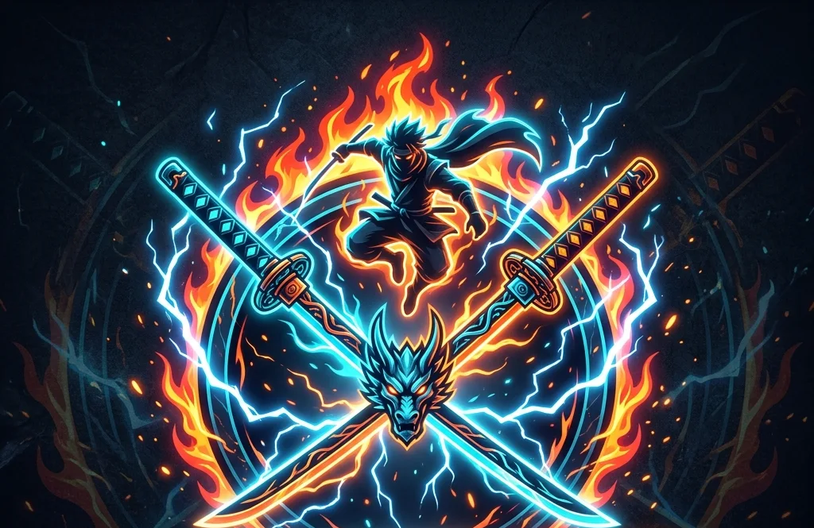

# Anime Legends

Anime Legends is a single-player arcade fighting game by Aun Abbas. Start as Blaze Warrior, face a CPU rival, and earn Spirit Shards to unlock the other nine elemental fighters. Play with a keyboard or touchscreen in a modern browser. [Play on Netlify](https://anime-legends-by-aun-abbas.netlify.app/)



## How to play

Choose **Enter the arena**, then **Choose fighter**. Pick a difficulty and match health, check your opponent, and select **Fight**. Land hits to build power. Walk into a weapon drop to equip it. The arena can drop a Katana, Spirit Bow, Chaos Orb, Shadow Blade, or Thunder Gauntlet.

Land another unblocked punch within 1.5 seconds of combat time to keep your combo going. The results screen shows your longest combo from the match alongside your personal best on this device.

A gold fist signals an incoming heavy punch. Start blocking in the final 0.1 seconds before contact for a **Perfect Guard**. Press **Light** within the next 0.45 seconds to throw a faster, stronger counter. You can keep holding Block. The results screen shows how many openings you turned into hits.

| Mode | How it plays |
| --- | --- |
| Timed match | Choose 100, 200, 300, or 400 HP. Win by knockout or by finishing the round with a higher percentage of health remaining. Equal health at the bell is a draw. |
| Expert | In a timed Expert match, knocking out the opponent brings out their stronger final boss form. |
| Survival | Select **Survival ∞** under match health. Face waves of stronger opponents and recover some health between waves. A knockout ends your run. To bank your current score early, open **Pause** and choose **Finish survival**. |

### Controls

| Action | Keyboard | Touchscreen |
| --- | --- | --- |
| Move | Left / right arrow | Drag the stick left / right |
| Jump | Up arrow | Drag the stick up |
| Light / heavy attack | `Z` / `X` | Tap **Light** / **Heavy** |
| Block | Hold `C` | Hold **Block** |
| Dash | `Space` | Tap **Dash** |
| Special, one power orb | Tap `V` | Tap **Power** |
| Ultimate, three power orbs | Hold `V` | Hold **Power** |
| Pause / resume | `Esc` | Tap **Pause** / **Resume** |

### Fighter roster

| Fighter | Element | Special | Ultimate |
| --- | --- | --- | --- |
| Blaze Warrior | Fire | Inferno Burst | Solar Flare |
| Shadow Ninja | Dark | Shadow Step | Thousand Shadows |
| Storm Fighter | Lightning | Thunder Crash | Divine Lightning |
| Frost Knight | Ice | Ice Spike | Glacial Zero |
| Terra Golem | Earth | Rock Smash | Earthquake |
| Aero Dancer | Wind | Gale Blade | Tornado Strike |
| Iron Brawler | Metal | Steel Punch | Meteor Crater |
| Venom Viper | Poison | Toxic Fang | Venomous Cloud |
| Aqua Siren | Water | Water Whip | Tsunami Surge |
| Soul Reaper | Spirit | Phantom Scythe | Soul Harvest |

### Progress and scores

A completed match earns one Spirit Shard for every 100 points. Spend shards in the **Spirit shop** on fighters, weapon skins, and boosts. Once purchased, a boost can be equipped again for free. You can equip two at a time.

The game saves progress in your browser. On a cloud-enabled deployment, open **Cloud save** from the main menu and choose **Create cloud backup**. Wait for **Your cloud backup is up to date**, then copy the private recovery code into a password manager. The backup includes shards, fighters, owned and equipped boosts and skins, best combo, and the top ten scores.

To recover after clearing browser data or changing devices, open the same game service, enter the code, choose **Review restore**, and confirm **Replace device progress**. Anyone with the code can read and update that backup. A lost code can still be copied from a linked device.

You can play offline. A linked device retries after reconnecting or reopening the game. **Sync now** retries immediately. If two devices changed independently, you can restore the cloud copy or keep the local progress under a separate code.

## Run locally

Use Node.js 24.15 or a later 24.x release, with its bundled npm. The repository includes an `.nvmrc` for Node version managers.

```sh
git clone https://github.com/AunMohammad254/anime-legends.git
cd anime-legends
npm ci
npm run dev
```

Open the local URL printed by Vite. The root path opens the landing page and `/game.html` opens the game. To test the touch controls on a phone over your local network, run `npm run dev -- --host` and open Vite's network URL on the phone.

### Connect a save database

Create a PostgreSQL database and set the server environment variable `DATABASE_URL` to its private connection URL. Use the same database role for initialization and the running function. Run `npm run db:init` once with that variable set. The command is safe to rerun. Both `npm run dev` and `npm run preview` serve the backup API when started with that environment.

The API stores a SHA-256 digest of each random 256-bit recovery code and a revision for its save. Conditional writes prevent a stale device from replacing newer progress. The server role owns the table. Other roles subject to row-level security have no policy granting access. For database-level disaster recovery, configure snapshots or point-in-time recovery with your PostgreSQL provider. [Database schema](database/schema.sql)

## Verify a release

From a clean checkout, run these commands from the repository root.

```sh
npm ci
npm run test:coverage -- --run
npm run build
npm run test:dist
npx playwright install chromium firefox webkit
npm run test:browser
```

The browser suite starts Vite's preview server on port 4173 and exercises the built game in desktop Chromium and Firefox, plus touch-emulated Chromium and WebKit. To run the database checks locally, point `TEST_DATABASE_URL` at a disposable PostgreSQL database, initialize it with `DATABASE_URL="$TEST_DATABASE_URL" npm run db:init`, then run `npm run test:database` and `npm run test:browser`. The cross-device restore test runs when `TEST_DATABASE_URL` is set. On a fresh Linux runner, use `npx playwright install --with-deps chromium firefox webkit` to install the browsers' system libraries too.

GitHub Actions runs the unit suite and builds the game on Linux and Windows. Each browser job gets its own PostgreSQL 17 service. Tests cover competing database writes, cross-device recovery, failed restores, shopping, combat, and keyboard and touch controls against the built game.

The Linux unit suite requires 100% line, statement, branch, and function coverage for each measured application JavaScript file. Open **unit-coverage** on the workflow run to inspect the V8 report. A failed browser job provides a **browser-failures** artifact for its engine with an HTML report, traces, and screenshots. Once all jobs pass, **anime-legends-dist** contains the build that the browsers tested. Checks run on pull requests, pushes to `main`, and manual runs. [Release checks](.github/workflows/check.yml)

## Deploy to Vercel or Netlify

1. Deploy this repository with Node.js 24.15 or a later 24.x release, build command `npm run build`, and output directory `dist`. Vercel discovers the function in `api/`. Netlify uses the function and rewrite in the repository configuration. Both serve `/api/progress`. [Vercel function](api/progress.js) · [Netlify configuration](netlify.toml)
2. Initialize the production database as described above. Put `DATABASE_URL` in the host's private **function runtime** environment and redeploy. Keep production credentials server-side. Use a separate database for preview deployments.
3. Open the deployed HTTPS game, create a backup, and restore it in a second browser profile. A static deployment of `dist/` supports local play. Cloud saves require the function and database.

## Project structure

| Path | Contents |
| --- | --- |
| `index.html`, `landing.js`, `landing.css` | Public landing page and gameplay preview |
| `game.html`, `main.js`, `index.css` | Game screens, startup, and arena styling |
| `engine.js`, `src/` | Battle loop, fighters, AI, input, sound, effects, UI, and saved state |
| `constants.js` | Fighter roster, weapons, skins, and boosts |
| `media/` | Artwork, font, and gameplay video |
| `tests/`, `e2e/` | Unit tests and browser release checks |

## Contributing

Fork the repository, create a feature branch, and open a pull request against `main`. Keep changes focused and include the checks you ran. For a gameplay bug, include your browser, device, mode, and steps to reproduce it. [Report a bug](https://github.com/AunMohammad254/anime-legends/issues) · [Contributors](https://github.com/AunMohammad254/anime-legends/graphs/contributors)

Created by **Aun Abbas**. [GitHub](https://github.com/AunMohammad254) · [Twitter](https://twitter.com/AunMohammad254) · [LinkedIn](https://linkedin.com/in/aunmohammad)

The game code is distributed under the MIT License. The bundled Barlow Condensed font uses the SIL Open Font License. [MIT License](https://opensource.org/license/mit/) · [Font license](public/licenses/barlow-condensed.txt)
