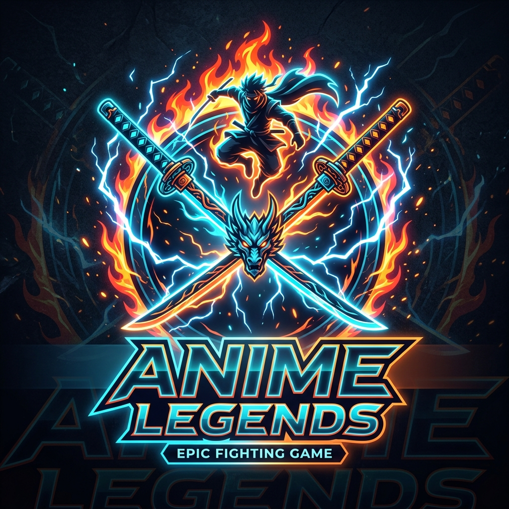

<div align="center">
  <a href="https://github.com/AunMohammad254/anime-legends">
    
  </a>

  <h1>Anime Legends</h1>

  <p>
    <a href="https://git.io/typing-svg">
      
    </a>
  </p>

  <p>
    <a href="https://github.com/AunMohammad254/anime-legends/stargazers">
      
    </a>
    <a href="https://github.com/AunMohammad254/anime-legends/network/members">
      
    </a>
    <a href="https://github.com/AunMohammad254/anime-legends/issues">
      
    </a>
    <a href="https://github.com/AunMohammad254/anime-legends/blob/master/LICENSE">
      
    </a>
    <a href="https://anime-legends-by-aun-abbas.netlify.app/">
      
    </a>
  </p>
</div>

<br />

<!-- TABLE OF CONTENTS -->
<details>
  <summary><kbd>📖 Table of Contents</kbd></summary>
  <ol>
    <li><a href="#-about-the-project">About The Project</a></li>
    <li><a href="#-roster--features">Roster & Features</a></li>
    <li><a href="#-getting-started">Getting Started</a>
      <ul>
        <li><a href="#prerequisites">Prerequisites</a></li>
        <li><a href="#installation">Installation</a></li>
      </ul>
    </li>
    <li><a href="#-usage--controls">Usage & Controls</a></li>
    <li><a href="#-project-structure">Project Structure</a></li>
    <li><a href="#-available-scripts">Available Scripts</a></li>
    <li><a href="#-deployment">Deployment</a></li>
    <li><a href="#-troubleshooting">Troubleshooting</a></li>
    <li><a href="#-contributing">Contributing</a></li>
    <li><a href="#-license">License</a></li>
    <li><a href="#-contact">Contact</a></li>
  </ol>
</details>

---

##  About The Project

**Anime Legends** is a browser-based, fast-paced fighting game built entirely with **HTML5 Canvas**, **Vanilla JavaScript**, and **Vite**. No plugins, no downloads — just open the browser and fight.

Choose from **10 elemental fighters**, equip **5 unique weapons**, purchase **stat boosts** from the in-game shop, and battle against a highly adaptive AI, survive escalating waves, and challenge formidable bosses. Every character has a distinct attack, a powerful **Special Move**, and a screen-clearing **Ultimate**.

<div align="center">
  <video src="images/punch-scene.mp4" autoplay loop muted playsinline width="650"></video>
</div>

### Why Anime Legends?

| ✅ Zero dependencies | ✅ Runs in any modern browser | ✅ 60 FPS on desktop |
|---|---|---|
| ✅ 10 playable characters | ✅ Mobile touch controls | ✅ In-game economy & shop |

---

##  Roster & Features

### 🥊 Fighter Roster

| Fighter | Element | Strengths | Special | Ultimate |
|---|---|---|---|---|
| **Blaze Warrior** *(Free)* | 🔥 Fire | High ATK | Inferno Burst | Solar Flare |
| **Shadow Ninja** | 🌑 Dark | Max Speed | Shadow Step | Thousand Shadows |
| **Storm Fighter** | ⚡ Lightning | Balanced | Thunder Crash | Divine Lightning |
| **Frost Knight** | ❄️ Ice | Max DEF | Ice Spike | Glacial Zero |
| **Terra Golem** | 🌍 Earth | High DEF | Rock Smash | Earthquake |
| **Aero Dancer** | 💨 Wind | Max Speed | Gale Blade | Tornado Strike |
| **Iron Brawler** | 🔩 Metal | Max ATK | Steel Punch | Meteor Crater |
| **Venom Viper** | ☠️ Poison | Speed/ATK | Toxic Fang | Venomous Cloud |
| **Aqua Siren** | 🌊 Water | Versatile | Water Whip | Tsunami Surge |
| **Soul Reaper** | 👻 Spirit | Speed/ATK | Phantom Scythe | Soul Harvest |

### ⚙️ Core Features

-  **Dynamic Combat Engine** — Frame-accurate hit detection, combo chains, blocking, and special move execution powered by a dedicated `CombatEngine`.
-  **Particle VFX & Spatial Audio** — A pooled particle system (500 particles, 0 GC pauses) paired with spatial audio cues for impactful combat feedback.
-  **In-Game Economy** — Earn coins from battles, then spend them in the Shop on new fighters, weapon skins, and stat-boost items.
-  **Mobile-Ready** — Touch controls automatically activate on mobile devices with responsive landscape / portrait layout.
-  **Performance Optimised** — Object pooling, a spatial grid for O(n) collision detection, and batch rendering keep the game locked at 60 FPS.

---

##  Getting Started

### Prerequisites

Ensure the following tools are installed before proceeding.

| Tool | Minimum Version | Download |
|---|---|---|
| **Node.js** | v16.0.0 | [nodejs.org](https://nodejs.org/) |
| **npm** | v8.0.0 | Bundled with Node.js |

> **Tip:** Verify your versions by running `node -v` and `npm -v` in a terminal.

### Installation

1. **Clone the repository**
   ```bash
   git clone https://github.com/AunMohammad254/anime-legends.git
   ```

2. **Navigate into the project directory**
   ```bash
   cd anime-legends
   ```

3. **Install dependencies**
   ```bash
   npm install
   ```

4. **Start the development server**
   ```bash
   npm run dev
   ```

5. Open the URL printed by Vite (usually `http://localhost:5173`) in your browser. The game loads instantly — no build step needed for development.

---

##  Usage & Controls

### Screenshots

<div align="center">
  
  <br/><br/>
  
  <br/><br/>
  
  <br/><br/>
  
</div>

<br/>

### Keyboard Controls

| Action | Input / Key | Details |
|---|---|---|
| **Move / Jump** | `Arrow Keys` | Standard character movement & jumping |
| **Light Attack** | `Z` | Quick, low-damage strike |
| **Heavy Attack** | `X` | Slower, high-damage strike |
| **Block** | `C` | Mitigate incoming combat damage (absorb 70% damage) |
| **Special Move** | `V` | Execute elemental special ability (Requires 1 Power Orb) |
| **Ultimate** | `Hold V` | Screen-clearing attack (Requires 3 Power Orbs) |
| **Dash** | `Space` | Quick directional evade (invulnerable frames) |

> **Mobile:** On-screen touch buttons appear automatically when a touch device is detected.

### Game Flow

```
Title Screen → Character Select → VS Screen → Battle → Results → (Rematch / Return)
```

1. **Character Select** — Select your champion. Locked characters can be purchased from the Shop using Spirit Shards.
2. **Battle** — Defeat the AI opponent (or survive waves / defeat the final boss) to win the match.
3. **Shop** — Spend earned Spirit Shards (💎) on new fighters, weapon skins, and power boosts.

---

##  Project Structure

```
anime-legends/
├── src/                          # Modular source code
│   ├── core/                     # Core engine systems
│   │   ├── Physics.js            # Collision detection & physics
│   │   ├── Renderer.js           # Batch rendering pipeline
│   │   └── SpatialGrid.js        # O(n) spatial partitioning
│   ├── entities/                 # Game entity classes
│   │   ├── Character.js          # Character entity & stats
│   │   └── Projectile.js         # Projectile lifecycle
│   ├── audio/
│   │   └── AudioManager.js       # Spatial audio management
│   ├── vfx/
│   │   └── ParticleSystem.js     # Pooled particle effects
│   └── utils/
│       ├── Config.js             # Centralised configuration
│       ├── EventBus.js           # Event-driven messaging
│       ├── ObjectPool.js         # GC-friendly object pooling
│       └── PerformanceMonitor.js # Real-time FPS & memory tracking
├── tests/                        # Vitest unit tests
│   ├── Physics.test.js
│   ├── Character.test.js
│   ├── Projectile.test.js
│   ├── EventBus.test.js
│   └── State.test.js
├── images/                       # Screenshots & media
├── engine.js                     # Main game loop & orchestration
├── combatengine.js               # Combat resolution logic
├── ui.js                         # UI rendering & screen management
├── state.js                      # Global game state
├── constants.js                  # Characters, weapons & game data
├── index.html                    # Entry point (title screen)
├── game.html                     # In-game screen
├── vite.config.js                # Vite build configuration
└── vitest.config.js              # Test configuration
```

---

##  Available Scripts

Run all commands from the project root with `npm run <script>`.

| Script | Command | Description |
|---|---|---|
| `dev` | `npm run dev` | Start the Vite development server with hot-reload |
| `build` | `npm run build` | Produce an optimised production bundle in `dist/` |
| `preview` | `npm run preview` | Serve the production build locally for verification |
| `test` | `npm test` | Run the full Vitest unit test suite |
| `test:ui` | `npm run test:ui` | Open the interactive Vitest UI dashboard |
| `test:coverage` | `npm run test:coverage` | Generate an HTML test coverage report |

---

##  Deployment

### Deploy to Netlify (Recommended)

1. Push your repository to GitHub.
2. Log in to [netlify.com](https://netlify.com) → **Add new site** → **Import from Git**.
3. Set the build settings:

   | Setting | Value |
   |---|---|
   | Build command | `npm run build` |
   | Publish directory | `dist` |

4. Click **Deploy**. Netlify will assign a live URL automatically.

> 🔗 **Live Demo:** [https://anime-legends-by-aun-abbas.netlify.app/](https://anime-legends-by-aun-abbas.netlify.app/)

### Deploy to GitHub Pages

```bash
# Build the project
npm run build

# Deploy the dist/ folder to the gh-pages branch
npx gh-pages -d dist
```

### Deploy to Vercel

```bash
# Install the Vercel CLI
npm install -g vercel

# Deploy from the project root
vercel --prod
```

---

##  Troubleshooting

| Problem | Likely Cause | Solution |
|---|---|---|
| `npm install` fails | Node.js version too old | Upgrade to Node.js v16+ |
| Blank screen on load | Browser blocks ES Modules from `file://` | Always use `npm run dev` instead of opening the HTML file directly |
| No audio | Browser autoplay policy | Click anywhere on the page to enable audio |
| Low FPS on mobile | Hardware limitation | Reduce particle effects in `src/utils/Config.js` |
| Port already in use | Another server is running | Run `npm run dev -- --port 3000` to use a different port |

> Still stuck? [Open an issue](https://github.com/AunMohammad254/anime-legends/issues) with your browser version, OS, and a description of the problem.

---

##  Contributing

Contributions are what make the open source community such an amazing place to learn, inspire, and create. Any contributions are **greatly appreciated**.

### Steps

1. **Fork** the repository
2. **Create** a feature branch
   ```bash
   git checkout -b feature/your-feature-name
   ```
3. **Commit** your changes with a descriptive message
   ```bash
   git commit -m "feat: add new character — Blaze Warrior Mk II"
   ```
4. **Push** to your fork
   ```bash
   git push origin feature/your-feature-name
   ```
5. **Open a Pull Request** against the `main` branch

### Guidelines

- Follow the existing code style (ESLint is configured — run `npx eslint .` before committing).
- Write or update unit tests in `tests/` for any new logic.
- Keep pull requests focused; one feature or fix per PR.

###  Contributors

<a href="https://github.com/AunMohammad254/anime-legends/graphs/contributors">
  
</a>

---

##  License

Distributed under the **MIT License**. See [`LICENSE`](LICENSE) for the full text.

---

##  Contact

**Aun Abbas** — [@AunMohammad254](https://twitter.com/AunMohammad254)

- 📁 Repository: [github.com/AunMohammad254/anime-legends](https://github.com/AunMohammad254/anime-legends)
- 🌐 Live Demo: [anime-legends-by-aun-abbas.netlify.app](https://anime-legends-by-aun-abbas.netlify.app/)

<div align="center">
  <a href="https://github.com/AunMohammad254">
    
  </a>
  <a href="https://twitter.com/AunMohammad254">
    
  </a>
  <a href="https://linkedin.com/in/aunmohammad">
    
  </a>
</div>